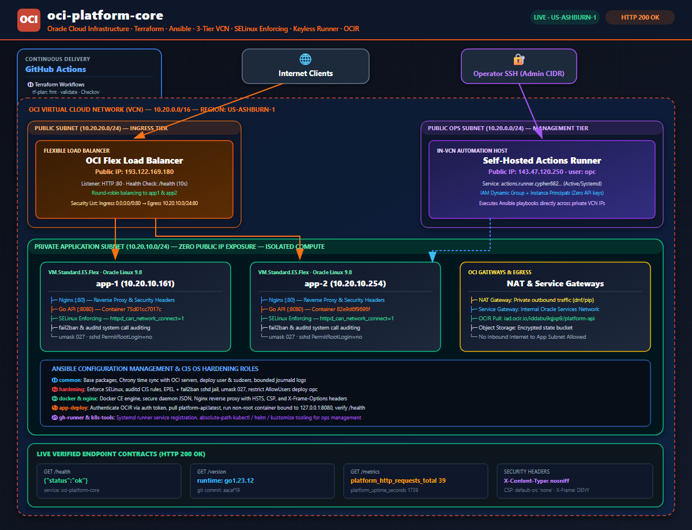

# oci-platform-core

[-blue?logo=terraform)](https://github.com/cypher682/oci-platform-core/actions)
[](https://github.com/cypher682/oci-platform-core/actions)
[](http://193.122.169.180/health)

Production-shaped Oracle Cloud Infrastructure platform built with Terraform and Ansible:
a private VM tier behind a public Flexible OCI Load Balancer, an in-cloud self-hosted GitHub Actions runner authenticated via IAM Instance Principals, CIS-aligned OS hardening (SELinux Enforcing, auditd, fail2ban, umask 027), Nginx reverse proxy with enterprise security headers, and continuous container deployment of a Go microservice via Oracle Cloud Infrastructure Registry (OCIR).

The repository is a working platform, not a diagram. Everything is codified and verified live on OCI (`us-ashburn-1`); the deployment verification is documented in [docs/evidence/README.md](docs/evidence/README.md).

## Live Verified Endpoints

The platform is live and verified across backend nodes:

- **Public Load Balancer:** `http://193.122.169.180/`
- **Health Check:** `http://193.122.169.180/health`
  ```bash
  $ curl -i http://193.122.169.180/health
  HTTP/1.1 200 OK
  Server: nginx
  X-Content-Type-Options: nosniff
  X-Frame-Options: DENY
  Referrer-Policy: no-referrer
  Content-Security-Policy: default-src 'none'; frame-ancestors 'none'

  {"status":"ok","service":"oci-platform-core","version":"aacaf19","hostname":"75d01cc7017c","time":"2026-11-18T15:00:50Z"}
  ```
- **Runtime & Version Info:** `http://193.122.169.180/version`
  ```json
  {"description":"OCI platform core sample workload","endpoints":["/health","/ready","/metrics"],"runtime":"go1.23.12","service":"oci-platform-core","version":"aacaf19"}
  ```
- **Prometheus Telemetry:** `http://193.122.169.180/metrics`
  ```text
  # HELP platform_http_requests_total Total HTTP requests handled
  # TYPE platform_http_requests_total counter
  platform_http_requests_total 39
  # HELP platform_uptime_seconds Seconds since process start
  # TYPE platform_uptime_seconds gauge
  platform_uptime_seconds 1739
  # HELP platform_build_info Build metadata
  # TYPE platform_build_info gauge
  platform_build_info{version="aacaf19",go="go1.23.12"} 1
  ```

Traffic is distributed via round-robin between two private backend nodes:
- `app-1`: `10.20.10.161` (hostname: `75d01cc7017c`)
- `app-2`: `10.20.10.254` (hostname: `82e9d6f9696f`)

## What is in the stack

| Layer | Resources | Code |
|---|---|---|
| Identity | Compartment, admin/reader groups, scoped policies, instance-principal dynamic group | `modules/iam` |
| Network | VCN `10.20.0.0/16`, public/app/db/OKE subnets, NSGs, flow logs | `modules/network` |
| Compute | 2 private app VMs + 1 public ops runner, OL9 cloud-init bootstrap | `modules/compute` |
| Ingress | Flexible OCI load balancer, HTTP health checks, optional TLS certificate | `modules/loadbalancer` |
| Containers | Basic OKE cluster + managed node pool, private worker subnet | `modules/oke` |
| Registry | Private OCIR repository | `modules/ocir` |
| Data | Always-free Autonomous Database, private endpoint | `modules/database` |
| Secrets | Vault key + database secret bundle | `modules/vault` |
| Storage | Encrypted evidence and state buckets | `modules/objectstorage` |
| Operations | ONS topic, CPU/DB alarms, OCI Bastion, budget + forecast alarms | `modules/observability`, `modules/bastion`, `modules/budget` |
| Configuration | Hardening, Docker, nginx, app deploy, OCI agent, self-hosted runner | `ansible/roles` |
| Delivery | Plan, apply, destroy, app build/deploy, Ansible workflows | `.github/workflows` |

## Architecture



```text
                          Internet
                             │
                    ┌────────┴────────┐
                    │  OCI Load       │  public subnet 10.20.0.0/24
                    │  Balancer :80   │
                    └────────┬────────┘
                             │ health check /
              ┌──────────────┴──────────────┐
              │                             │
     ┌────────┴────────┐          ┌─────────┴───────┐
     │ app VM 1        │          │ app VM 2        │  app subnet 10.20.10.0/24
     │ nginx + Go app  │          │ nginx + Go app  │  no public IP
     └────────┬────────┘          └─────────┬───────┘
              └──────────────┬──────────────┘
                             │
                    ┌────────┴─────────┐
                    │ Autonomous DB    │  db subnet 10.20.20.0/24
                    │ private endpoint │
                    └──────────────────┘

  ops runner (public subnet, admin CIDR only) ── Ansible/SSH ──► app VMs
  GitHub Actions ── OCI API ──► Terraform, OCIR, OKE
  OKE workers ── private subnet 10.20.30.0/24 ──► OCIR pull, OCI LB service
```

Two compute planes are deliberate: the VM tier proves configuration management and
traditional operations; OKE proves container delivery. Both consume the same image
from OCIR and expose the same `/health` contract.

## Deploy from the pipeline

The primary path is GitHub Actions, not a local workstation. One-time setup:

```bash
bash scripts/bootstrap-state.sh   # creates the OCI state bucket + S3-compatible key
```

Then add the repository secrets listed in [docs/credentials.md](docs/credentials.md)
and:

1. **Actions → Terraform Plan** — validates, lints, scans, and plans on a PR or
   manual run.
2. **Actions → Terraform Apply** — choose `dev`, type `APPLY`. Terraform creates
   the stack, deploys the workload to OKE, and smoke-tests the VM load balancer.
3. **Actions → Ansible Configuration** — runs on the self-hosted ops runner and
   reconciles the app VMs.
4. **Actions → Build and Deploy Application** — builds the Go image, pushes to
   OCIR, and rolls out the new tag.

The workflows authenticate by writing `~/.oci/config` from secrets; no credential
is committed and no local OCI CLI profile is required.

Local commands remain available for validation and debugging:

```bash
make preflight      # checks the DB password + OCI auth; optional vars are skipped
make init
make validate
make plan           # needs terraform.tfvars or TF_VAR_* exports
```

Ansible runs **on the ops runner**, because the app VMs have no public IP:

```bash
ssh -i ~/.ssh/oci_platform deploy@$(terraform -chdir=environments/dev output -raw ops_runner_public_ip)
cd oci-platform-core/ansible
ansible-playbook site.yml -i inventory/hosts.ini
```

The ops runner is the intended host for the self-hosted GitHub Actions runner
(`ansible/roles/gh-runner`), which is why the Ansible workflow targets
`[self-hosted, linux, x64, oci-platform]`.

## Repository layout

```text
environments/dev|prod     Root modules, tfvars examples, backend example
modules/                  Twelve Terraform modules, each with versions.tf
ansible/                  Playbook, roles, static and OCI dynamic inventory
app/                      Go service, scratch Docker image, unit tests via HTTP
k8s/                      Namespace, deployment, service, HPA, PDB, NetworkPolicy
scripts/                  Preflight, inventory, smoke test, evidence capture
.github/                  OCI auth action and five delivery workflows
docs/                     Architecture, credentials, security, cost, runbook, ADRs
```

## Delivery model

- `tf-plan.yml` — format, validate, TFLint, Checkov, plan, PR comment.
- `tf-apply.yml` — manual, environment-gated apply; deploys the workload to OKE and
  smoke-tests the VM load balancer.
- `app-build-push.yml` — builds the Go image, pushes to OCIR, rolls out to OKE.
- `ansible.yml` — runs on the self-hosted ops runner and reconciles the VM tier.
- `destroy.yml` — manual teardown with a typed confirmation.

No credential is stored in the repository. CI writes `~/.oci/config` from GitHub
secrets in a composite action, and Terraform reads it the same way as a laptop.

## Cost and teardown

The stack is sized for a short portfolio sprint on a trial credit, not for an
always-on production budget. Load balancer hours, OKE worker hours, and block
volumes dominate the bill; ADB runs on the ECPU model (2 ECPUs, 20 GB) and bills
too. See
[docs/cost.md](docs/cost.md) for the line items and the budget guardrail.

```bash
make destroy ENV=dev
```

Destroy the stack when evidence is captured. A running OKE node pool and load
balancer will consume credit continuously.

## Documentation

- [Pipeline setup — where every value comes from](docs/pipeline-setup.md)
- [`scripts/gh-secrets.sh`](scripts/gh-secrets.sh) — upload OCI values with `gh secret set`
- [Credentials you must supply](docs/credentials.md)
- [Architecture and failure modes](docs/architecture.md)
- [Runbook](docs/runbook.md)
- [Security posture and residual risk](docs/security.md)
- [Cost model](docs/cost.md)
- [Evidence checklist](docs/evidence/README.md)
- [ADRs](docs/adr/)
